# Agent guide: Techorama 2026 Aspire slides

Instructions for any coding agent (Copilot, Claude Code, Codex, Cursor…) editing the slides in this `slides/` folder. They apply only to the slides, not to the code samples elsewhere in the repo. Read this file and `docs/design-guidelines.md` before changing a slide, and start new slides from `templates/index.html`. All paths below are relative to `slides/`.

## Repo layout

| Path | What it is |
| --- | --- |
| `aspireify/index.html` | "Aspireify your app in an hour", Tue 27 Oct, Room 13 |
| `agents/index.html` | "Use agents to build agents with Aspire + Microsoft Agent Framework", Wed 28 Oct, Room 12 |
| `templates/index.html` | A runnable gallery deck: one example of every slide layout, ready to copy |
| `docs/design-guidelines.md` | Brand and layout rules (colors, type scale, spacing, components, voice) |
| `docs/brand/tokens.json` | Aspire design system tokens (source of truth for colors and type) |
| `shared/deck.js` | Shared Reveal.js initialization, npm imports, image previews and motion preferences |
| `shared/` | Local fonts, images and `deck.css`, shared by every deck |
| `index.html` | Landing page that links both decks |

The repository root owns the npm manifest, lockfile and Vite configuration. Build tooling and npm dependencies are allowed. Use the existing Vite multi-page build rather than copying library distributions into `shared/` or introducing a second build system. Keep dependency changes intentional and commit the lockfile with them.

The **built decks must present without an internet connection**. Bundle runtime dependencies, fonts and images; do not depend on a CDN at presentation time. External resource links are fine. `npm run build` creates `dist/`, which can be served locally or deployed to a static host, including a repository subpath. Do not edit or commit generated `dist/` files.

## How a slide is built

Every slide is one `<section>` inside `.slides`, holding exactly one `.slide` div that carries the whole layout as inline styles, plus optional speaker notes:

```html
<section id="my-slide" data-transition="fade">
<div class="slide" style="background:linear-gradient(160deg,#171b31 0%,#1b2140 55%,#213051 100%);color:#f6f3ff;font-family:'Poppins', Arial, sans-serif;padding:208px 128px 128px;display:flex;flex-direction:column;gap:56px">
  
  <h2 style="font-size:72px;font-weight:600;letter-spacing:-2px;line-height:1.08">Slide title in sentence case</h2>
  <!-- content -->
</div>
<aside class="notes">What the speaker says. Plain text.</aside>
</section>
```

Rules:

- The canvas is fixed at **1920 × 1080**. Reveal.js scales it to the screen; never use `vw`, `vh`, `%` font sizes or responsive layout media queries. Accessibility queries such as `prefers-reduced-motion` are allowed.
- **Margins:** `padding:208px 128px 128px` on content slides (the logo sits at top 80px, left 128px). The usable area is 1664 × 744.
- Keep one-off composition styles inline. Put reusable components, typography, accessibility and shared slide rules in `shared/deck.css`; avoid duplicating shared styling across decks.
- Every deck loads `<script type="module" src="../shared/deck.js"></script>`. Keep Reveal configuration and plugin imports there rather than repeating initialization per page.
- Use native `.fragment` elements for deliberate, click-to-reveal builds. Group related arrows and content with the same `data-fragment-index`; keep the first comparison or process step visible on arrival. Avoid decorative autoplay, and preserve instant state changes for reduced-motion users.
- For a dashboard image that needs an enlarged view, wrap its `` in an accessible `<a href="..." data-preview-image aria-label="...">`. The shared setup resolves the preview URL from the bundled image. Escape returns to the slide.
- Each talk starts with the Techorama opener (`#techorama`), then its conference title (`#cover`), then the speaker slide. Use the original template artwork in `shared/img/techorama-*.png`; keep the session text editable in HTML. These two slides intentionally use the conference branding, not an Aspire logo overlay.
- Conference titles use the template's local DS Wallau and Alegreya fonts; keep their license notices in `public/font-licenses/` with deployed builds. Closing slides use the matching session review image (`agents-review-qr.png` or `aspireify-review-qr.png`) at its original aspect ratio; do not substitute the other session's QR.
- Every other slide shows the Aspire logo top-left at the same position, except where a template omits it.
- Slide `id`s are used in URLs (`#/my-slide`). Keep them short, lowercase and unique within a deck, and do not rename existing ones.
- Speaker notes go in `<aside class="notes">`. Press `S` while presenting to see them.
- Icons are inline Lucide SVGs (`viewBox="0 0 24 24"`, `stroke="currentColor"`, `stroke-width="1.8"`, no fill). Copy one from an existing slide, or take the path from the Lucide icon set. Never use emoji as icons.
- Images live in `shared/img/` and are referenced as `../shared/img/<file>`.

## Content and voice

- Always "Aspire", never ".NET Aspire".
- Sentence case for every title and label. Uppercase is only for the small mono eyebrows, done with `text-transform:uppercase`.
- Speak to the audience as "you". Short claim, then a plain-language payoff.
- CLI commands are lowercase and in Fira Code: `aspire init`, `aspire run`, `aspire start --isolated`.
- One idea per slide. If it needs more than ~6 lines of body text, split it or move the detail to speaker notes.
- Do not invent statistics, quotes or API names. Code on slides must match the demo repos; mark anything illustrative as "Illustrative example".
- Use typographic punctuation in text people read (’ “ ” —); straight quotes only inside code.

## Checking your work

From the **repository root**:

```sh
npm ci
npm run dev
npm run build
npm run preview
```

Use the development server while editing, then inspect the production preview before finishing. Step through every changed slide and fragment in both directions; check that nothing overflows the 1920 × 1080 frame or overlaps the logo. Verify fonts, images, speaker notes and image previews resolve from the build. Press `Esc` for the overview grid. Do not use a plain file server on the source folder: npm imports require Vite.

## Source of truth

The HTML decks, shared styles and shared Reveal setup in this repository are the source of truth. Edit them directly and rebuild with Vite; do not replace them with an external slide export.
